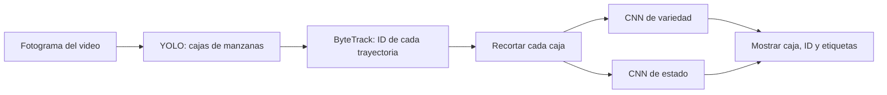

# Plan de desarrollo: inspección de manzanas con redes neuronales

**Materia:** Aprendizaje Automático II · Maestría en Inteligencia Artificial

**Fecha:** 22 de octubre de 2026

**Actualización:** 29 de octubre de 2026; reparto propuesto para los cuatro integrantes en la sección 20.

**Estado:** plan original de octubre. Para ver qué se implementó, los resultados y los pendientes, consultar [Estado del proyecto](ESTADO_DEL_PROYECTO.md).

Vamos a construir un programa que reciba un video, encuentre las manzanas y muestre sobre cada una su variedad y su estado visible. Usaremos YOLO con fine-tuning para detectar, dos CNN entrenadas desde cero para clasificar y ByteTrack para mantener un identificador mientras cada manzana se mueve.

El trabajo tiene dos entregas inseparables: **un sistema que se pueda mostrar y un estudio que permita explicar cómo se entrenó, qué aprendió y dónde falla**. El código debe ser lo suficientemente simple como para recorrerlo y explicarlo en clase.

## Cómo usar este documento

Leer primero las secciones 1 a 4. Después seguir los pasos de desarrollo en orden. Cada paso termina con una evidencia concreta que permite saber si está terminado.

**Primera tanda de trabajo:** preparar el entorno, revisar los datos y fijar las particiones (pasos 1–4). Después entrenar una CNN pequeña y comprobarla antes de integrar el video. Las extensiones no bloquean la entrega principal.

- [1. Objetivo y alcance](#1-objetivo-y-alcance)
- [2. Qué pide la materia](#2-qué-pide-la-materia)
- [3. Qué vamos a investigar](#3-qué-vamos-a-investigar)
- [4. Cómo funcionará el sistema](#4-cómo-funcionará-el-sistema)
- [5. Datos y fuentes](#5-datos-y-fuentes)
- [6. Organización del código](#6-organización-del-código)
- [7. Preparar y separar los datos](#7-preparar-y-separar-los-datos)
- [8. Entrenar las dos CNN](#8-entrenar-las-dos-cnn)
- [9. Hacer fine-tuning de YOLO](#9-hacer-fine-tuning-de-yolo)
- [10. Integrar imágenes y video](#10-integrar-imágenes-y-video)
- [11. Evaluar el trabajo](#11-evaluar-el-trabajo)
- [12. Experimentos y registro de resultados](#12-experimentos-y-registro-de-resultados)
- [13. Comparación opcional con multitarea](#13-comparación-opcional-con-multitarea)
- [14. Pruebas del código y reproducibilidad](#14-pruebas-del-código-y-reproducibilidad)
- [15. Orden de trabajo y entregas](#15-orden-de-trabajo-y-entregas)
- [16. Informe y presentación](#16-informe-y-presentación)
- [17. Riesgos y decisiones pendientes](#17-riesgos-y-decisiones-pendientes)
- [18. Lista de cierre](#18-lista-de-cierre)
- [19. Fuentes y lecturas](#19-fuentes-y-lecturas)
- [20. División del trabajo entre cuatro personas](#20-división-del-trabajo-entre-cuatro-personas)

## 1. Objetivo y alcance

**Objetivo:** desarrollar y evaluar un sistema de visión que detecte manzanas, clasifique cuatro variedades y distinga entre defectuosas y no defectuosas a partir de imágenes, con una demostración de procesamiento de video.

### Alcance principal

| Tarea | Entrada | Salida | Cómo se construye |
|---|---|---|---|
| Detección | Imagen o fotograma completo | Una caja y un puntaje por manzana detectada | YOLO preentrenado, luego fine-tuning con Apple Sorting |
| Variedad | Recorte de una manzana | Granny Smith, Red Delicious, Pink Lady o Crimson Snow | CNN entrenada desde cero con Fruits-360 |
| Estado | Recorte de una manzana | Defectuosa o no defectuosa | Otra CNN entrenada desde cero con HDF |
| Seguimiento | Detecciones de cuadros consecutivos | ID de trayectoria | ByteTrack, integrado con Ultralytics |
| Demostración | Video | Cajas, ID, variedad, estado y velocidad medida | Python y OpenCV |

En este trabajo, **“no defectuosa” significa que la imagen pertenece a la clase sin defectos visibles del dataset**. No demuestra que el interior de la fruta esté sano. La clasificación binaria tampoco identifica la causa de una enfermedad. HDF contiene distintos tipos de daño, pero inicialmente los agruparemos en una sola clase defectuosa.

Las cuatro variedades son el universo de clasificación inicial. Una quinta variedad puede recibir erróneamente el nombre de una de esas cuatro. Mostrar baja confianza como “Revisar” ayuda a la demo, pero no convierte al modelo en un detector confiable de variedades desconocidas.

### Qué aporta como trabajo de materia

El aporte está en preparar los datos con criterio, entrenar redes que podamos explicar, comparar alternativas con las mismas condiciones y estudiar qué ocurre al pasar de fotografías a recortes de video. Una mejora que no funciona también produce un resultado útil si el experimento está bien hecho.

## 2. Qué pide la materia

Se revisaron el programa 2026 y la presentación de la materia disponibles en `01_Clases`.

| Instancia | Entrega o actividad |
|---|---|
| Clase 4 | Definición del proyecto, según la presentación inicial |
| Clase 6 | Avance del trabajo: 5 a 10 minutos y preguntas, según la presentación |
| Clase 7 | Selección de tres papers, según la presentación |
| Clase 9 | Defensa de un paper: 4 minutos y preguntas, según la presentación |
| Clase 11 | Informe, código comentado y presentación final |

El programa asigna 20% a la defensa del paper, 30% a la presentación inicial del TP y 50% a la presentación final. La presentación inicial de la materia indica 10 minutos más preguntas para la defensa final. Confirmar cualquier actualización que haya comunicado el equipo docente.

El informe debe contener: **título, abstract, introducción, trabajos relacionados, métodos y datos, resultados y conclusiones**.

La base de código más cercana es `02_Practicas/3_CNN.ipynb`: ya trabaja con convoluciones, pooling, `CrossEntropyLoss`, Adam y un ciclo explícito de entrenamiento. Lo adaptaremos a imágenes RGB y agregaremos validación, guardado del mejor modelo y métricas por clase.

## 3. Qué vamos a investigar

### Pregunta principal

**¿Podemos combinar un detector adaptado a manzanas y clasificadores pequeños entrenados desde cero para obtener una inspección útil, y qué errores aparecen al llevarla a video?**

### Comparaciones que forman parte del trabajo

1. **YOLO preentrenado frente a YOLO con fine-tuning.** Medir si mejora la localización sobre el mismo conjunto reservado.
2. **Cada CNN sin aumentos frente a la misma CNN con aumentos moderados.** Medir si cambian el desempeño y el sobreajuste.
3. **Clasificación aislada frente a funcionamiento integrado.** Separar lo que funciona en fotos del dataset de lo que se puede comprobar sobre recortes y videos.
4. **Calidad frente a velocidad.** Medir el costo de ejecutar detección, seguimiento y ambos clasificadores en el mismo programa.

Las hipótesis son expectativas, no conclusiones: el fine-tuning podría mejorar la detección; los aumentos podrían ayudar con cambios de iluminación; los fondos y las vistas de video podrían empeorar las clasificaciones. Los resultados decidirán.

La CNN multitarea queda como **extensión experimental después de completar esta base**. No reemplaza silenciosamente lo presentado en las slides.

## 4. Cómo funcionará el sistema



**Durante el entrenamiento**, cada modelo recibe sus propios datos y etiquetas. **Durante la demo**, los modelos ya entrenados reciben imágenes nuevas; sus pesos no cambian.

YOLO aprende con imágenes y cajas. Si las imágenes provienen de un video, se entrenaría con sus fotogramas anotados. Nuestra primera versión usará las imágenes ya anotadas de Apple Sorting: no requiere etiquetar todas las manzanas a mano ni entrenar una red temporal.

Las dos CNN pueden ejecutarse una después de la otra sobre el mismo lote de recortes. No hace falta programar hilos ni dos procesos. Se cargan una sola vez al iniciar y se mide el tiempo total. ByteTrack asocia detecciones; sus IDs no equivalen a una identidad permanente de cada fruta.

## 5. Datos y fuentes

### 5.1 Selección principal

| Datos | Uso | Cantidad prevista | Qué falta verificar al preparar los archivos |
|---|---|---:|---|
| [Apple Sorting v2](https://universe.roboflow.com/arfiani-nur-sayidah-9lizr/apple-sorting-2bfhk/dataset/2) | Fine-tuning de detección | 697 imágenes publicadas | Exportación, partición exacta, calidad de cajas, duplicados y procedencia |
| [Fruits-360 original-size](https://github.com/fruits-360/fruits-360-original-size/tree/e09de71fa3e80624be016e1b5c90c1c310d046c5) | Variedad | 2.501 imágenes en las cuatro carpetas elegidas | Independencia entre objetos y secuencias; imágenes utilizables |
| [Healthy-Defective-Fruits](https://github.com/luischuquim/Healthy-Defective-Fruits/tree/967ef53c60e195fcda3d64cff90d28cacfc50540/apple_images/apple_real_images) | Estado | 5.000 imágenes reales de manzanas | Agrupación de fotos relacionadas, etiquetas y archivos utilizables |

Son tres conjuntos para tres tareas. **No tenemos un único dataset que etiquete caja, variedad, estado e identidad para todas las manzanas.** No se deben inventar las etiquetas que faltan.

La comprobación de esta fecha incluyó documentación pública y listados de archivos, no una auditoría visual completa ni la descarga de los datasets. Los conteos definitivos serán los obtenidos después de revisar el material.

### 5.2 Apple Sorting para detectar

La [ficha del proyecto](https://universe.roboflow.com/arfiani-nur-sayidah-9lizr/apple-sorting-2bfhk) publica dos clases: `apple` y `damaged_apple`, licencia CC BY 4.0 y un conjunto de 697 imágenes asociado a la versión 2. La página específica de esa versión no pudo abrirse directamente durante esta revisión; confirmar su exportación antes del primer entrenamiento.

Para nuestro detector, convertir ambas clases en **`manzana`** y conservar las coordenadas de cada caja. El archivo original se mantiene intacto; la conversión se hace sobre una copia procesada. No asumir que los números de clase tienen un orden: leer el `data.yaml` exportado.

La plataforma también muestra un modelo Roboflow y sus métricas. Esos resultados no son resultados nuestros ni demuestran que haya un checkpoint YOLO listo para reutilizar.

### 5.3 Fruits-360 para variedad

Conteo de archivos de imagen verificado mediante la API pública de GitHub para el commit `e09de71fa3e80624be016e1b5c90c1c310d046c5`:

| Carpeta original | Nombre que mostraremos | Training | Validation | Test | Total |
|---|---|---:|---:|---:|---:|
| `apple_granny_smith_1` | Granny Smith | 320 | 160 | 160 | 640 |
| `apple_red_delicios_1` | Red Delicious | 300 | 150 | 150 | 600 |
| `apple_pink_lady_1` | Pink Lady | 313 | 156 | 156 | 625 |
| `apple_crimson_snow_1` | Crimson Snow | 318 | 159 | 159 | 636 |
| **Total** | | **1.251** | **625** | **625** | **2.501** |

**Advertencia metodológica concreta:** el [README de esa versión](https://github.com/fruits-360/fruits-360-original-size/blob/e09de71fa3e80624be016e1b5c90c1c310d046c5/README.md) describe la captura por rotación y una partición intercalada de imágenes de cada objeto. El test oficial puede contener vistas muy relacionadas con entrenamiento. No demuestra por sí solo generalización a frutas físicas nuevas. Licencia publicada: CC BY-SA 4.0.

La decisión sobre cómo evaluar este problema se toma en el paso 3; no se resuelve cambiando aleatoriamente los nombres de las carpetas.

### 5.4 HDF para estado

Conteo verificado en el árbol de GitHub del commit `967ef53c60e195fcda3d64cff90d28cacfc50540`:

| Carpeta original | Imágenes reales | Etiqueta de entrenamiento |
|---|---:|---|
| `fresh` | 2.500 | No defectuosa |
| `bruise_defect` | 750 | Defectuosa |
| `rot_defect` | 1.000 | Defectuosa |
| `scab_defect` | 750 | Defectuosa |
| **Total** | **5.000** | **2.500 por clase binaria** |

Conservar también el subtipo original para analizar errores por golpe, podredumbre y sarna. El repositorio incluye material sintético; la primera comparación usa solamente fotografías reales. El [registro de Mendeley](https://data.mendeley.com/datasets/p73b8byghp/1) indica CC BY 4.0 y remite a GitHub para los archivos. No hay etiquetas de variedad verificadas para estas imágenes.

### 5.5 Videos para la demo

| Fuente | Uso propuesto | Qué permite afirmar |
|---|---|---|
| [Google Coral: apple.mp4](https://github.com/google-coral/demo-manufacturing/blob/main/test_data/apple.mp4) | Primer video: integración y seguimiento en una escena sencilla | Que el programa procesa ese clip y cuánto demora |
| [apple_counting: input.mp4](https://github.com/muhammadrahman-hehe/apple_counting/blob/18617b11bb1d58e2c059ea2600c2e07a3408334f/videos/input.mp4) | Escena de cinta con muchas manzanas; prueba de carga y oclusiones | Comportamiento de la demo en una escena más difícil |

Estos clips no aportan etiquetas verificadas de variedad y estado para cada fruta. No calcular “precisión del video” comparando las predicciones con lo que parece verse. La licencia y procedencia del segundo clip requieren revisión antes de redistribuirlo; se puede conservar su enlace como referencia.

Si se quiere medir formalmente seguimiento con IDs existentes, [AppleMOTS](https://zenodo.org/records/5939726) es una extensión posible: contiene 1.700 fotogramas de huerto con máscaras e identidades. No valida calidad ni variedad en una cinta.

## 6. Organización del código

### Paso 1. Preparar una estructura pequeña

Esta estructura es una propuesta para crear durante la implementación. No indica que esos programas ya existan.

```text
inspeccion-de-manzanas/
├── README.md
├── requirements.txt
├── config.py
├── datos.py
├── modelos.py
├── entrenar_cnn.py
├── entrenar_yolo.py
├── evaluar.py
├── demo.py
├── notebooks/
│   ├── 01_explorar_datos.ipynb
│   └── 02_analizar_resultados.ipynb
├── tests/
│   └── test_datos_y_recortes.py
├── datos/
│   ├── originales/
│   ├── preparados/
│   ├── particiones/
│   └── videos/
├── pesos/
└── resultados/
    └── nombre_del_experimento/
```

| Archivo | Responsabilidad |
|---|---|
| `config.py` | Rutas, clases, tamaños y parámetros iniciales, con valores visibles |
| `datos.py` | Inventario, separación, lectura de imágenes y transformaciones |
| `modelos.py` | Una clase `CNN` que recibe el número de clases; se instancia dos veces |
| `entrenar_cnn.py` | Entrenamiento, validación y guardado para la tarea elegida |
| `entrenar_yolo.py` | Llamada explícita al entrenamiento de Ultralytics |
| `evaluar.py` | Métricas, predicciones guardadas y tablas comparables |
| `demo.py` | Lectura del video, detección, recortes, clasificación y dibujo |

**Reglas para que se entienda:** funciones cortas con nombres concretos; comentarios en español que expliquen decisiones; constantes visibles; rutas relativas a la carpeta del proyecto; ninguna clave personal en el código. Usar clases solamente donde aporten, como `nn.Module` y el dataset de PyTorch. Los notebooks llaman a las funciones de los archivos, sin copiar el entrenamiento en varias celdas diferentes.

Tecnologías necesarias: Python, PyTorch, torchvision, Ultralytics, OpenCV, NumPy, pandas, matplotlib, Pillow y scikit-learn. Para comparar mAP con un mismo evaluador, usar TorchMetrics con su dependencia `pycocotools`; no hace falta utilizar un framework de entrenamiento adicional.

Elegir un entorno compatible, comprobar los imports y luego fijar las versiones que funcionaron en `requirements.txt`. Registrar versión de Python, PyTorch, Ultralytics, dispositivo y sistema operativo. No copiar una combinación de versiones sin probarla.

**Evidencia para cerrar el paso:** entorno que importa las librerías, README con instrucciones de ejecución y una imagen cargada correctamente. Todavía no se necesita entrenar.

## 7. Preparar y separar los datos

### Paso 2. Hacer un inventario y revisar ejemplos

1. Obtener las versiones elegidas cuando comience la implementación y guardar fuente, versión o commit, fecha y licencia.
2. Mantener los originales sin modificar. Guardar la preparación en otro directorio.
3. Contar imágenes por clase, resolución y partición. Comprobar que se pueden abrir.
4. Revisar visualmente al menos 20 ejemplos por clase y todos los casos sospechosos. Ese número es una revisión inicial, no una certificación del dataset.
5. Buscar copias exactas con SHA-256 y posibles imágenes relacionadas con similitud visual. La similitud propone candidatos; una persona decide si son el mismo objeto o captura.
6. Revisar duplicados entre fuentes si alguna se usará como prueba externa. Un repositorio distinto no garantiza imágenes independientes.
7. En Apple Sorting, dibujar una muestra de las cajas sobre las imágenes y comprobar omisiones, cajas fuera del cuadro y clases mal asignadas.
8. Registrar exclusiones y correcciones con un motivo; nunca borrar solamente los ejemplos que el modelo predice mal.

Crear `manifest.csv`, una tabla de archivos con estas columnas mínimas:

```text
ruta,fuente,version,etiqueta_original,etiqueta_final,grupo,particion,sha256,observaciones
```

`grupo` representa el fruto, sesión, secuencia o conjunto de imágenes relacionadas. Si no se conoce, dejar constancia de ello. No inventar un ID físico a partir de un nombre de archivo ambiguo.

**Evidencia:** inventario, ejemplos por clase, registro de problemas y conteos finales. Las cifras de las slides se actualizan más adelante si cambian después de la limpieza.

### Paso 3. Definir entrenamiento, validación y prueba

- **Entrenamiento:** se usa para aprender los pesos.
- **Validación:** se usa para elegir configuración, mejor época y umbrales.
- **Prueba o test:** se reserva para evaluar la configuración ya elegida.

Separar por grupo antes de aumentar imágenes o extraer cuadros. Todas las vistas, recortes y transformaciones del mismo original permanecen en la misma partición. Fijar la semilla y guardar los listados; no volver a sortearlos en cada entrenamiento.

| Fuente | Decisión de separación |
|---|---|
| Apple Sorting | Revisar la partición exportada. Conservarla si es utilizable e independiente; si hay grupos cruzados, generar una partición corregida y documentar el cambio. No mezclar resultados de particiones diferentes. |
| HDF real | Proponer 70% entrenamiento, 15% validación y 15% prueba, por grupos y procurando representación de las clases y subtipos. Las cantidades exactas dependen de los grupos; no forzar porcentajes rompiéndolos. |
| Fruits-360 | Conservar el split oficial únicamente como referencia interna claramente identificada. Investigar si existen varios frutos o sesiones independientes por variedad para construir una prueba adicional por grupo. |
| Videos | Separar por video, sesión o fruto físico conocido. La repetición de una manzana en el mismo clip no crea nuevas muestras independientes. |

Se puede usar [`GroupShuffleSplit`](https://scikit-learn.org/stable/modules/generated/sklearn.model_selection.GroupShuffleSplit.html) en dos pasos para separar grupos; no garantiza estratificación por clase. Revisar los conteos resultantes y la ausencia de grupos compartidos.

**Decisión obligatoria sobre variedad:** si Fruits-360 no contiene suficientes grupos independientes por clase, no se puede fabricar una evaluación de frutas nuevas con sus vistas. Buscar un conjunto adicional con esas variedades y procedencia comprobable, o limitar explícitamente la conclusión a reconocimiento dentro del dataset. Una captura adicional puede ayudar si se dispone de ella, pero no es una dependencia de hardware para completar el trabajo.

Con HDF, si no se recupera la identidad física de todas las frutas, agrupar las relaciones que sí se puedan identificar y declarar la independencia restante como una limitación. Quitar duplicados exactos no alcanza para garantizarla.

El equipo que desarrolla no usa test para decidir cambios. Después de elegir todo en validación, ejecutar la evaluación final de los modelos fijados. Si se desarrolla sobre ese test posteriormente, pasa a ser parte del desarrollo y deja de ser una prueba nueva.

**Evidencia:** tres listados por tarea, conteos por clase y grupo, comprobación de grupos disjuntos y una explicación de lo que cada test realmente mide.

### Paso 4. Preparar etiquetas e imágenes

**Detección:** exportar las cajas existentes a formato YOLO. Cada línea describe `clase centro_x centro_y ancho alto`, con coordenadas normalizadas entre 0 y 1. Convertir las clases de manzana a `0`, sin cambiar las cajas. Verificar límites y dimensiones positivas. El [formato oficial](https://docs.ultralytics.com/datasets/detect/) incluye el YAML con las rutas y nombres de clase.

**Variedad:** guardar un diccionario explícito, por ejemplo `0: Granny Smith`, `1: Red Delicious`, `2: Pink Lady`, `3: Crimson Snow`. Reutilizarlo al entrenar, evaluar y mostrar resultados. No depender del orden alfabético que una librería asigne por su cuenta.

**Estado:** `0: No defectuosa`, `1: Defectuosa`. Conservar el subtipo original en el manifiesto, aunque el modelo tenga solo dos salidas.

Para ambas CNN: imágenes RGB, redimensionado a 128 × 128 manteniendo proporciones mediante relleno, tensor con valores entre 0 y 1. Usar exactamente el mismo preprocesamiento al evaluar y en la demo. Los cuadros de OpenCV llegan en BGR: convertir los recortes a RGB antes de pasarlos a las CNN. Ultralytics gestiona su propio preprocesamiento del fotograma.

Los aumentos se aplican únicamente durante entrenamiento. No generar aumentos antes de la separación. En validación y prueba, la transformación debe ser determinista.

**Evidencia:** un lote visualizado, etiquetas correctas, forma `[cantidad, 3, 128, 128]` y cajas superpuestas correctamente.

## 8. Entrenar las dos CNN

### Paso 5. Construir una red pequeña y explicar cada capa

Usar la misma arquitectura para las dos tareas, con pesos independientes y distinta cantidad de salidas. Es una arquitectura inicial propuesta, no una red ya validada.

| Capa | Salida por imagen | Para qué está |
|---|---|---|
| Entrada RGB | 3 × 128 × 128 | Color e información visual |
| Conv 3×3, 16 filtros, padding 1 + ReLU + MaxPool 2×2 | 16 × 64 × 64 | Primeros patrones y reducción de tamaño |
| Conv 3×3, 32 filtros, padding 1 + ReLU + MaxPool 2×2 | 32 × 32 × 32 | Combinaciones de patrones |
| Conv 3×3, 64 filtros, padding 1 + ReLU + MaxPool 2×2 | 64 × 16 × 16 | Características más elaboradas |
| AdaptiveAvgPool 4×4 + Flatten | 1.024 valores | Tamaño fijo para la parte final |
| Linear 1.024→64 + ReLU + Dropout 0,25 | 64 valores | Combinar características y regularizar |
| Linear 64→K | 4 o 2 valores | Puntajes de cada clase |

Usar `nn.Sequential` donde simplifique la lectura y un `forward` corto. Las capas se inicializan aleatoriamente; las CNN no usan pesos de ImageNet. Para aprender la implementación, apoyarse en el notebook de la materia y en el [tutorial de modelos de PyTorch](https://docs.pytorch.org/tutorials/beginner/basics/buildmodel_tutorial.html).

La última capa devuelve **logits**, puntajes sin normalizar. Usar `CrossEntropyLoss` con etiquetas enteras. No colocar `softmax` antes de esa pérdida. En inferencia sí se puede aplicar `softmax` para presentar puntajes por clase, sin interpretarlos automáticamente como probabilidades calibradas.

**Evidencia:** un lote produce `[cantidad, 4]` o `[cantidad, 2]`; se imprime el número de parámetros y se puede explicar cómo cambian las dimensiones.

### Paso 6. Verificar el ciclo con pocas imágenes

Antes de una corrida larga, elegir unas 16 a 32 imágenes del entrenamiento, desactivar aumentos y dropout para esta prueba y comprobar que la red puede aprender ese pequeño conjunto. Esta comprobación detecta problemas de etiquetas, gradientes o preprocesamiento; no es un resultado de generalización.

El ciclo que debe quedar visible en el código es:

```python
model.train()
for imagenes, etiquetas in loader_entrenamiento:
    imagenes, etiquetas = imagenes.to(device), etiquetas.to(device)
    optimizer.zero_grad()
    logits = model(imagenes)
    perdida = criterion(logits, etiquetas)
    perdida.backward()
    optimizer.step()
```

En validación usar `model.eval()` y `torch.inference_mode()`, sin optimizador ni actualización de pesos. Para el aprendizaje de este ciclo, consultar el [tutorial de optimización de PyTorch](https://docs.pytorch.org/tutorials/beginner/basics/optimization_tutorial.html).

**Evidencia:** pérdida que baja en el conjunto pequeño y gradientes que se actualizan. Si falla, corregir esto antes de aumentar épocas o tamaño de la red.

### Paso 7. Ejecutar los entrenamientos comparables

Valores de partida para las dos CNN, modificables a partir de validación:

| Parámetro | Valor inicial propuesto |
|---|---|
| Tamaño | 128 × 128 RGB |
| Batch | 32 |
| Optimizador | Adam |
| Learning rate | 0,001 |
| Weight decay | 0,0001 |
| Máximo de épocas | 40 |
| Early stopping | 8 épocas sin mejora en macro-F1 de validación |
| Mejor checkpoint | Mayor macro-F1 de validación; desempate por menor pérdida |
| Semilla de desarrollo | 42 |

Primero entrenar sin aumentos. Después repetir cambiando solo los aumentos: volteo horizontal, pequeñas rotaciones y variación moderada de brillo/contraste. Como punto de partida, rotaciones de hasta 15° y brillo/contraste de hasta 15%; revisar ejemplos transformados antes de entrenar. Evitar cambios fuertes de tono, conversiones a gris y recortes que borren el defecto o modifiquen pistas de variedad. [`ColorJitter`](https://docs.pytorch.org/vision/stable/generated/torchvision.transforms.ColorJitter.html) permite controlar esas transformaciones por separado.

Guardar por época pérdida y macro-F1 de entrenamiento/validación, además de precisión y recall de defectuosas. Si se compara la métrica de entrenamiento con validación, medirla también sin aumentos y en modo evaluación; la pérdida durante entrenamiento con dropout no es exactamente la misma condición.

Guardar el mejor `state_dict`, la arquitectura, el mapeo de clases, el preprocesamiento, la configuración y la mejor época. Reabrir ese archivo y comprobar que produce las mismas predicciones en modo evaluación. El [tutorial de guardado de PyTorch](https://docs.pytorch.org/tutorials/beginner/saving_loading_models.html) sirve como referencia.

Para los finalistas, repetir las comparaciones con semillas 42, 123 y 2026, manteniendo fija la partición. Reportar media y dispersión; no elegir solo la semilla que dio mejor. Si se hace una sola corrida, indicarlo como limitación.

**Evidencia:** pesos separados de variedad y estado, curvas de aprendizaje, predicciones de validación y comparación con/sin aumentos.

Vocabulario para explicar el entrenamiento: un **batch** es un lote de imágenes; una **época** es una pasada por el entrenamiento; la **pérdida** mide el desacuerdo con las etiquetas; **backpropagation** calcula gradientes; el **optimizador** usa esos gradientes para cambiar los pesos; el **learning rate** controla el tamaño de esos cambios. **Dropout** desactiva algunas unidades durante entrenamiento para regularizar; **early stopping** detiene la corrida cuando deja de mejorar en validación. El **checkpoint** guarda el estado aprendido.

## 9. Hacer fine-tuning de YOLO

### Paso 8. Medir el detector original y entrenar una adaptación

Punto de partida recomendado para la implementación: **YOLO26n**, por ser una variante pequeña disponible en la [documentación oficial](https://docs.ultralytics.com/models/yolo26/). El archivo es `yolo26n.pt`. Fijar la versión de Ultralytics y el checkpoint utilizado. La elección es una recomendación de este plan; todavía no fue probada en nuestro entorno.

1. Cargar el modelo preentrenado y comprobar algunas imágenes de entrenamiento/validación.
2. Buscar la clase `apple` en `model.names`; no copiar un número de clase sin comprobarlo.
3. Guardar sus predicciones de validación como referencia inicial.
4. Entrenar otra instancia que parte de los mismos pesos sobre Apple Sorting convertido a una clase.
5. Usar 640 píxeles como tamaño inicial de entrada, batch 16, máximo 50 épocas y paciencia 10. Como receta explícita inicial: AdamW, learning rate 0,001 y weight decay 0,0005. Ajustar por validación y memoria disponible; registrar todos los parámetros efectivos.
6. Hacer fine-tuning de las capas entrenables del modelo; no congelarlas inicialmente. El framework adapta la salida al nuevo número de clases. Guardar el registro de pesos transferidos y capas efectivamente entrenadas.
7. Usar `best.pt`, seleccionado con validación por Ultralytics. Registrar el criterio efectivo de selección, llamado `fitness`, y su relación con mAP en la versión instalada. No elegir el checkpoint mirando test.
8. Comparar con el detector original usando la misma partición y evaluador.

La [API de entrenamiento de Ultralytics](https://docs.ultralytics.com/modes/train/) permite cargar pesos y ejecutar `model.train(...)`. Usaremos esa implementación para detección; el ciclo de aprendizaje de las CNN quedará escrito explícitamente por nosotros.

**Qué debemos poder explicar:** el modelo ya aprendió características visuales en el preentrenamiento; el fine-tuning continúa el aprendizaje con las imágenes y cajas de nuestra tarea. La pérdida de detección penaliza errores de localización y clasificación según la implementación de YOLO elegida. Documentar esa versión y sus pérdidas reales, sin atribuirle automáticamente las de otra generación de YOLO.

### Comparación correcta de los dos YOLO

El original tiene múltiples clases y el entrenado tendrá una sola. Para comparar:

- Conservar únicamente las predicciones de `apple` del original y convertir su ID a `0` en la evaluación.
- Usar `0` también para las anotaciones y predicciones del detector adaptado.
- Evaluar ambos sobre las mismas imágenes, con coordenadas en píxeles de la imagen original.
- Usar resolución, límite de detecciones y configuración de postprocesamiento comparables y registrados.
- Para mAP, conservar predicciones con un umbral bajo común, por ejemplo 0,001, y calcular la curva completa; el umbral visible de la demo es otra decisión.
- Usar un evaluador común: [`MeanAveragePrecision` de TorchMetrics](https://lightning.ai/docs/torchmetrics/stable/detection/mean_average_precision.html), con cajas `xyxy`, puntajes y etiquetas. Comprobar su límite de detecciones por imagen; no truncar un modelo de forma distinta del otro.

Los resultados de `model.val()` sirven para controlar el entrenamiento. La tabla comparativa final debe usar el mismo protocolo para los dos modelos. No comparar el mAP publicado por Roboflow con nuestro mAP como si fueran el mismo experimento.

**Evidencia:** configuración, pesos, curva de validación, predicciones originales/adaptadas y una comparación que permita saber si el fine-tuning ayudó. Si empeora, se reporta y se analiza; la demo puede usar el mejor modelo validado, dejando claro cuál es.

## 10. Integrar imágenes y video

### Paso 9. Resolver una imagen completa antes de trabajar con video

1. Cargar YOLO y las dos CNN una sola vez.
2. Detectar las manzanas en una imagen.
3. Llevar las coordenadas a enteros y recortarlas a los límites de la imagen.
4. Descartar recortes vacíos. Registrar los demasiado pequeños para clasificar con sentido.
5. Guardar la correspondencia entre cada caja y su recorte.
6. Convertir los recortes a RGB, aplicar el preprocesamiento y juntarlos en un lote.
7. Ejecutar la CNN de variedad y la CNN de estado sobre ese mismo lote.
8. Volver a unir los resultados por la correspondencia guardada y dibujarlos.

No emparejar etiquetas solo por el orden de una lista si se eliminaron recortes inválidos. Ese error puede mostrar el estado de una manzana sobre la caja de otra.

La escena debe mostrar resultados entendibles: `ID 12 · Granny Smith · Defectuosa`. Los puntajes y tiempos detallados se guardan en una tabla, sin llenar la pantalla de números.

**Evidencia:** una imagen con varias manzanas y correspondencia comprobada entre cajas, recortes y resultados.

### Paso 10. Procesar el video cuadro por cuadro

Usar [`cv2.VideoCapture`](https://docs.opencv.org/4.x/dd/d43/tutorial_py_video_display.html) para leer el archivo. Para simplificar, utilizar el seguimiento que ya integra Ultralytics y elegir explícitamente `tracker="bytetrack.yaml"`. El tracker predeterminado de una versión puede ser otro.

Esquema del programa, no código terminado:

```text
cargar detector y clasificadores
abrir video
para cada fotograma:
    detectar y actualizar ByteTrack
    obtener cajas e IDs disponibles
    recortar y preparar el lote
    clasificar variedad
    clasificar estado
    unir resultados con sus cajas e IDs
    dibujar y registrar tiempos
cerrar video y archivos
```

La llamada `model.track(fotograma, persist=True, tracker="bytetrack.yaml")` mantiene el estado entre cuadros consecutivos. Reiniciar el tracker al cambiar de video o volver al inicio; no arrastrar identidades de un archivo a otro. Esta conducta está documentada en [Ultralytics Tracking](https://docs.ultralytics.com/modes/track/).

Comprobar que el umbral del detector permite conservar las detecciones de menor confianza que ByteTrack usa para asociar trayectorias. Registrar la configuración del tracker; no reutilizar automáticamente el umbral elegido para mostrar cajas en una imagen estática.

Manejar explícitamente cuadros sin detecciones, detecciones todavía sin ID, fruta parcialmente visible, final del archivo y fallo al abrir el video. Un ID puede cambiar después de una oclusión; el tracking no garantiza reconocer la misma fruta cuando reaparece mucho más tarde.

Guardar una tabla por detección:

```text
video,frame,tiempo_video,id,x1,y1,x2,y2,score_detector,
variedad,score_variedad,estado,score_defecto,ms_total
```

Esta tabla contiene **predicciones**, no etiquetas verdaderas. Si se agregan anotaciones de evaluación, guardarlas en otro archivo.

### Paso 11. Preparar una demo clara

- Comenzar con un clip sencillo y luego mostrar el de varias manzanas.
- Mostrar cajas legibles, ID y dos etiquetas; evitar líneas largas de trayectoria que tapen la escena.
- Mostrar FPS medidos del sistema y la condición de ejecución.
- Agregar “Revisar” para casos de baja confianza o recortes inutilizables, con una regla elegida usando validación.
- Guardar también el resultado sin esa regla para que la abstención no oculte errores.
- Preparar una grabación de respaldo del programa real y aclarar cuándo se reproduce ese respaldo.

Al principio clasificar cada cuadro procesado. Si las etiquetas parpadean, una mejora opcional es promediar puntajes en una ventana corta por ID. Comparar antes/después: puede estabilizar, pero también retrasar la aparición de un defecto. La condición visible puede cambiar al girar la fruta; no convertir un promedio de vistas en una garantía sobre toda la manzana.

**Evidencia:** demo que completa ambos clips sin fallar, tabla de predicciones y velocidad medida. Una pantalla bonita no cierra todavía la evaluación de calidad.

## 11. Evaluar el trabajo

### Paso 12. Evaluar cada parte y después la combinación

| Parte | Datos de prueba | Métrica principal | Qué mirar además |
|---|---|---|---|
| YOLO | Imágenes con cajas reservadas | mAP@0.50:0.95 | mAP@0.50, precisión, recall y manzanas omitidas |
| CNN de variedad | Imágenes con variedad conocida | Macro-F1 | F1 por variedad, accuracy y matriz de confusión |
| CNN de estado | Imágenes reales con estado conocido | Recall de defectuosas, acompañado de precisión | F1 de defectuosas, macro-F1, matriz y errores por subtipo |
| Detección + estado | Imágenes con cajas y estado compatibles, reservadas | Recall completo de defectuosas | Falsos rechazos y errores de cada etapa |
| Video completo | Clips fijados antes de la medición | FPS y latencia | Carga por cuadro, cuadros omitidos y memoria |
| Seguimiento, si hay IDs verdaderos | Secuencias anotadas | IDF1 o cambios de ID bajo un protocolo definido | Pérdidas de trayectoria y oclusiones |

Reportar siempre cantidad de imágenes, objetos y grupos evaluados. Una tabla con cientos de fotogramas del mismo fruto no equivale a cientos de frutas distintas.

### Qué significa cada métrica

Para estado, la clase positiva es **Defectuosa**:

```text
TP: defectuosa que clasificamos como defectuosa
FN: defectuosa que clasificamos como no defectuosa
FP: no defectuosa que clasificamos como defectuosa

Recall = TP / (TP + FN)
Precisión = TP / (TP + FP)
F1 = 2 × Precisión × Recall / (Precisión + Recall)
Macro-F1 = promedio del F1 de cada clase, con el mismo peso por clase
```

El recall responde cuántas defectuosas encontramos. La precisión responde cuántas de las que rechazamos realmente tenían la etiqueta defectuosa. Hay que mostrar ambas: decir que todo está defectuoso puede dar recall alto y ser inútil. Para macro-F1 usar todas las clases definidas y manejar divisiones por cero explícitamente, como permite [scikit-learn](https://scikit-learn.org/stable/modules/generated/sklearn.metrics.f1_score.html).

En detección, **IoU** mide el solapamiento de la caja predicha y la anotada. AP resume precisión/recall al variar el umbral; mAP@0.50:0.95 exige distintos niveles de solapamiento. Con una sola clase, el promedio entre clases contiene solo manzana. Consultar las [métricas de Ultralytics](https://docs.ultralytics.com/guides/yolo-performance-metrics/).

Para precisión y recall de detección a un umbral concreto, hacer correspondencias uno a uno con IoU ≥ 0,50: una caja no puede acertar dos manzanas, y una segunda predicción sobre la misma manzana es un falso positivo. Esta revisión complementa el evaluador de AP, no lo reemplaza.

### Umbrales sin usar test

Primero reportar el clasificador de estado con umbral 0,50 sobre el puntaje de defectuosa. Después, si interesa priorizar encontrar defectos, explorar umbrales en validación y elegir uno con una regla escrita antes de mirar test.

Ejemplo de regla propuesta: maximizar precisión entre umbrales que logren recall ≥ 0,90 en validación; si ninguno lo consigue, informar que ese objetivo no se alcanzó. El 0,90 es un objetivo experimental elegido por el equipo, no una exigencia industrial ni un resultado prometido. Reportar también cuántas muestras positivas sostienen la estimación.

Separar ese umbral binario del umbral que activa “Revisar”. Si el programa se abstiene, publicar **cobertura**: proporción de muestras en que emitió una decisión. Presentar la matriz completa sin abstención y los resultados sobre los casos aceptados; no mejorar artificialmente el resultado eliminando los difíciles.

### Aprovechar Apple Sorting para una evaluación integrada

Conservar sus etiquetas originales aunque se unifiquen las clases para entrenar YOLO. En el test reservado, esas anotaciones podrían permitir evaluar **caja + estado** sin etiquetar otro conjunto entero:

1. Revisar que `apple` significa no defectuosa y `damaged_apple` defectuosa en las anotaciones utilizadas; no asumirlo solo por el nombre.
2. Acordar una definición de daño visible compatible con HDF antes de ver las predicciones del sistema. Marcar los casos ambiguos con una revisión independiente y publicar cuántos se excluyen de esta comparación.
3. Comprobar que esas imágenes o frutos no aparecen en entrenamiento de HDF ni del detector.
4. Ejecutar YOLO, recortar y clasificar estado en los objetos detectados.
5. Hacer correspondencias con las cajas verdaderas. Contar como fallo del sistema una manzana defectuosa omitida por YOLO, aunque nunca haya llegado a la CNN.

```text
Recall completo de defectuosas =
defectuosas correctamente localizadas y clasificadas / defectuosas anotadas evaluables
```

Mostrar también los falsos rechazos y las falsas detecciones. La precisión de rechazo del sistema debe incluir las predicciones defectuosas que no corresponden a una fruta anotada. Un recorte inválido o una abstención no cuenta como acierto; informar esas cantidades aparte.

Si las etiquetas originales no permiten esta equivalencia, usar Apple Sorting solamente para detección y documentar que falta un conjunto para esa evaluación integrada. Esto no obliga a volver a etiquetar todos los datos de entrenamiento.

**Para validar variedad y estado juntos en video** se necesitan ambas etiquetas verdaderas en esas frutas. No se puede calcular ese resultado mezclando el F1 de Fruits-360 con el F1 de HDF. Una anotación pequeña de prueba, si se decide hacerla, es distinta de preparar miles de cajas para entrenar: definir fuente, criterio, responsable de revisión y desacuerdos, sin usar las predicciones como verdad.

### Medir velocidad de forma defendible

1. Registrar equipo, dispositivo, versiones, resolución de entrada, tamaño de YOLO y de las CNN.
2. Cargar los modelos una vez y hacer un calentamiento breve, por ejemplo 30 cuadros; separar ese tiempo del funcionamiento estable y reiniciar la secuencia de medición.
3. Medir lectura, detección/seguimiento, recortes, ambas CNN y dibujo. Registrar por separado visualización, espera de reproducción y escritura de video si se utilizan.
4. En GPU, sincronizar correctamente antes y después del intervalo medido; de otro modo se puede medir solo el envío de trabajo. Usar la sincronización correspondiente a CUDA o MPS cuando aplique.
5. Medir el clip completo al menos tres veces. Informar FPS globales, latencia mediana y percentil 95 por cuadro; el P95 es el tiempo que no supera el 95% de los cuadros.
6. Separar escenas con pocas y muchas manzanas. Más recortes implican más trabajo de clasificación.

```text
FPS de procesamiento = cuadros procesados / segundos de procesamiento medidos
Latencia por cuadro = tiempo desde la lectura hasta el resultado de ese cuadro
```

No promediar los recíprocos de tiempos para obtener los FPS globales. Medir el cociente anterior. No presentar los milisegundos internos de YOLO como tiempo del sistema completo.

“Tiempo real a 30 FPS” requiere sostener la entrada de 30 cuadros por segundo bajo las condiciones declaradas, sin acumular retraso. El intervalo disponible es aproximadamente 33,3 ms por cuadro. Verificarlo también con reproducción al ritmo de entrada; procesar un archivo fuera de línea no comprueba por sí solo el retraso de una transmisión.

Si se procesa un video de 60 FPS tomando uno de cada dos cuadros, declararlo como entrada efectiva de 30 FPS y 50% de cuadros procesados. Guardar un MP4 a 30 FPS no demuestra que se calculó a esa velocidad. Si no se alcanza el objetivo, publicar la velocidad real.

### Analizar errores, además de producir promedios

Armar una galería de 12 a 20 casos con imagen, etiqueta verdadera, predicción y puntaje. Incluir aciertos y errores de todas las clases, no solo ejemplos atractivos.

Buscar: frutas pequeñas, oclusiones, reflejos, desenfoque, defectos sutiles, variedades parecidas, fondos nuevos, recortes que pierden información y cambios de ID. Separar fallo de localización de fallo del clasificador. Si se usa Grad-CAM, tratarlo como una ayuda visual para analizar atención aparente, no como una prueba de que la red razona correctamente.

Las tres semillas muestran variación del entrenamiento. No miden por sí solas incertidumbre sobre otras poblaciones de frutas. Si se agregan intervalos por remuestreo, hacerlo por fruto o grupo independiente, no tratando fotogramas correlacionados como muestras nuevas.

**Evidencia:** tablas finales con contexto, curvas, matrices, ejemplos de error y un apartado explícito de lo que pudo y no pudo medirse.

## 12. Experimentos y registro de resultados

### Paso 13. Hacer pocas comparaciones, bien controladas

| ID | Experimento | Qué cambia | Qué se mantiene |
|---|---|---|---|
| D0 | YOLO preentrenado | Referencia sin entrenamiento nuestro | Imágenes y protocolo de evaluación |
| D1 | YOLO con fine-tuning | Pesos aprendidos con Apple Sorting | Arquitectura, datos de prueba y evaluador de D0 |
| V0 / V1 | CNN de variedad sin/con aumentos | Transformaciones de entrenamiento | Arquitectura, particiones y receta de optimización |
| E0 / E1 | CNN de estado sin/con aumentos | Transformaciones de entrenamiento | Arquitectura, particiones y receta de optimización |
| S0 | Sistema integrado | Ejecución de los modelos seleccionados | Clips y condiciones de medición fijos |
| M1, opcional | CNN compartida con dos salidas | Compartir extracción de características | Tareas, datos y criterios de comparación |

Agregar como referencia simple un clasificador que siempre predice la clase más frecuente de entrenamiento. Calcular sus métricas en los mismos conjuntos. Superarlo es una comprobación básica, no una demostración de calidad industrial.

Durante desarrollo usar validación. Fijar después qué versiones entran en la tabla final y evaluarlas sin cambiar decisiones según test. Si se quiere estudiar tamaño de entrada, profundidad o suavizado temporal, elegir una sola comparación adicional con una pregunta concreta.

Cada carpeta de experimento debe guardar:

- Configuración utilizada, semilla, versión del código y de los datos.
- Conteos y listados de las particiones, o referencia inequívoca a ellos.
- Historial por época y criterio de elección del checkpoint.
- Pesos, mapeo de clases y preprocesamiento.
- Predicciones individuales y métricas derivadas.
- Tiempo de entrenamiento, entorno y observaciones.

Una tabla de resultados vacía se prepara desde el comienzo y se completa únicamente con mediciones:

| Modelo | Test / versión | Macro-F1 variedad | Recall defectuosas | Precisión defectuosas | mAP50-95 | FPS sistema | P95 ms |
|---|---|---:|---:|---:|---:|---:|---:|
| Por completar | Por completar | — | — | — | — | — | — |

Usar “no aplica” o “no evaluado” donde corresponda. No todas las filas tienen todas las métricas, y la tabla no implica que exista un test conjunto para ambas clasificaciones.

### Cómputo

Las CNN propuestas son pequeñas. Empezar con una GPU disponible para entrenar y usar CPU o MPS para comprobar el código si hace falta; medir la demo en el equipo donde se presentará. No se necesita una cinta física ni una cámara industrial.

Antes de estimar duración, medir tres épocas de prueba por tipo de modelo. Estimar tiempo como épocas previstas por tiempo medido por época, más evaluación y guardado. Registrar memoria máxima observada. Si falta memoria, bajar batch antes de cambiar toda la arquitectura. Los tiempos de una GPU publicada en un benchmark no son los de nuestro equipo.

## 13. Comparación opcional con multitarea

### Paso 14. Compartir una CNN si la versión base ya está completa

Construir una CNN con un extractor compartido y dos salidas: cuatro puntajes de variedad y dos de estado. Es una alternativa a las dos CNN, no un cuarto modelo que se deba sumar a la demo.

Como los datasets no tienen ambas etiquetas, alternar lotes de cada tarea:

```text
Lote de Fruits-360:
    calcular pérdida de variedad
    actualizar extractor compartido y salida de variedad

Lote de HDF:
    calcular pérdida de estado
    actualizar extractor compartido y salida de estado
```

No rellenar las etiquetas ausentes ni convertirlas en una clase inventada. Los lotes pueden alternarse 1:1 como receta inicial, registrando cuántas veces se ve cada dataset. Si se combinan pérdidas en un mismo paso, normalizar cada tarea por sus ejemplos etiquetados y documentar sus pesos.

Comparar contra las dos CNN con los mismos datos, aumentos y exposiciones a cada tarea, además de registrar el tiempo total de entrenamiento. Evaluar macro-F1 de variedad, recall/precisión de estado, cantidad de parámetros y latencia de ambas predicciones sobre el mismo lote.

El extractor compartido puede ahorrar cálculo, pero las tareas también pueden interferir. Además, los datasets provienen de entornos diferentes: compartir una red no elimina ese problema. Adoptar la variante solo si el resultado medido justifica el cambio. [Referencia sobre multitarea](https://arxiv.org/abs/1706.05098).

**Evidencia:** tabla con las dos arquitecturas y sus ventajas o pérdidas reales. Si no se llega a hacer, queda como trabajo futuro y la entrega base sigue siendo completa.

## 14. Pruebas del código y reproducibilidad

### Paso 15. Comprobar los puntos que pueden invalidar el resultado

Estas pruebas son pequeñas y concretas; no hace falta construir una infraestructura de testing compleja.

| Comprobación | Error que evita |
|---|---|
| Ningún grupo ni duplicado conocido cruza particiones | Contaminación entre entrenamiento y prueba |
| Imágenes, etiquetas y cajas coinciden | Entrenar con una etiqueta o caja ajena |
| Los IDs de clase coinciden al guardar y cargar | Mostrar una variedad diferente a la predicha |
| Las cajas normalizadas se convierten a píxeles correctamente | Recortar otra región o medir mal IoU |
| Una imagen de colores conocidos pasa correctamente de BGR a RGB | Intercambiar canales al llevar las CNN a video |
| Se conserva la asociación tras eliminar un recorte inválido | Poner la etiqueta de una fruta en otra |
| Un cuadro sin manzanas no produce un error | Caída del programa en una entrada normal |
| Reiniciar un video reinicia el seguimiento | Mezclar identidades de secuencias diferentes |
| Guardar y cargar conserva las predicciones en evaluación | Checkpoint incompleto o preprocesamiento distinto |

Además, comprobar las métricas con un ejemplo diminuto calculado a mano: una defectuosa acertada, una omitida y una fruta buena rechazada; para cajas, una coincidencia perfecta, una omitida y una detección duplicada. Una prueba de este tipo detecta un error del evaluador que afectaría todas las conclusiones.

Registrar semillas de Python, NumPy y PyTorch, así como las del muestreo y los aumentos. El entrenamiento puede tener diferencias entre dispositivos o versiones aunque se use la misma semilla; documentarlo en vez de prometer igualdad bit a bit. [Notas oficiales de reproducibilidad](https://docs.pytorch.org/docs/stable/notes/randomness.html).

### Cómo debería poder ejecutarlo otra persona

Los comandos siguientes son la interfaz que proponemos implementar; todavía no existen esos scripts:

```bash
python datos.py --auditar
python entrenar_cnn.py --tarea variedad
python entrenar_cnn.py --tarea estado
python entrenar_yolo.py
python evaluar.py --particion test
python demo.py --video datos/videos/prueba.mp4
```

El README final debe explicar preparación del entorno, fuentes de datos, preparación de archivos, entrenamiento, evaluación y demo. Tiene que permitir ejecutar la demo con pesos guardados sin repetir todo el entrenamiento. Para comprobarlo, otra persona del grupo ejecuta las instrucciones desde un entorno limpio.

Usar Git durante la implementación para el código y documentos. Mantener datasets, videos, entornos virtuales y checkpoints grandes fuera de los commits habituales; documentar dónde se obtienen. Registrar atribuciones y licencias de datos y código utilizados. No subir secretos de Roboflow ni de otros servicios.

**Evidencia:** comprobaciones que pasan y ejecución por una segunda persona siguiendo únicamente el README.

## 15. Orden de trabajo y entregas

No hay un calendario de días impuesto en este documento. Usar los hitos de la materia y avanzar por resultados comprobables.

| Etapa | Pasos | Entrega que habilita continuar |
|---|---|---|
| A. Acordar alcance | 1 y decisiones de las secciones 1–4 | Objetivo, métricas y estructura entendidos |
| B. Preparar evidencia | 2–4 | Datos auditados, particiones y etiquetas fijas |
| C. Aprender a entrenar | 5–7 | Dos CNN, curvas y primeros resultados de validación |
| D. Adaptar detección | 8 | Comparación de YOLO original y con fine-tuning |
| E. Integrar | 9–11 | Una imagen completa y luego los videos funcionando |
| F. Medir | 12–13 | Resultados comparables y análisis de errores |
| G. Extender, si aporta | 14 | Comparación multitarea opcional |
| H. Entregar | 15 y sección 16 | Código reproducible, informe y defensa ensayada |

Para el avance de clase 6, priorizar datos, particiones, una CNN entrenada, curva de aprendizaje y detección funcionando. Llevar problemas reales identificados y la próxima comparación, además de capturas de la demo.

Para la entrega final, reservar una etapa completa para medir, escribir y ensayar. La cantidad de experimentos puede recortarse; la separación correcta de datos y la evaluación de lo que se afirma no deberían recortarse.

## 16. Informe y presentación

### Paso 16. Escribir a partir de evidencia guardada

| Parte del informe | Contenido que debe quedar |
|---|---|
| Título | Qué tarea resuelve y con qué enfoque |
| Abstract | Problema, método, datos, resultados reales principales y límite más importante; escribirlo al final |
| Introducción | Uso esperado y pregunta experimental |
| Trabajos relacionados | Qué hacen YOLO, estudios de defectos y seguimiento; qué tomamos y qué cambia en nuestro caso |
| Métodos y datos | Arquitecturas, preparación, grupos, particiones, entrenamiento, umbrales y protocolo |
| Resultados | Tablas, curvas, matrices, velocidad y comparaciones controladas |
| Discusión y conclusiones | Qué aprendimos, hipótesis confirmadas o rechazadas, límites y siguiente mejora |
| Referencias y material reproducible | Fuentes, código, configuraciones, pesos y forma de repetir la evaluación |

Figuras mínimas útiles: esquema del sistema, ejemplos de datos, curvas de las CNN, matrices de confusión, comparación de YOLO y una imagen de la demo real. Identificar como ilustración cualquier imagen preparada antes del entrenamiento; no presentarla como una predicción obtenida.

Escribir el método mientras se implementa. Cada afirmación de resultado debe poder rastrearse a una tabla de predicciones o registro. Evitar afirmaciones generales como “alta precisión” si no vienen acompañadas de métrica, cantidad de muestras y condiciones.

### Paso 17. Preparar una defensa de diez minutos

Guion orientativo, adaptable a lo que confirme el docente:

1. **1 minuto:** problema y salida esperada.
2. **2 minutos:** datos, etiquetas y cómo se evitó mezclar ejemplos relacionados.
3. **2 minutos:** YOLO, fine-tuning, CNN y ciclo de entrenamiento.
4. **2 minutos:** comparaciones y resultados medidos.
5. **2 minutos:** demo y un fallo representativo.
6. **1 minuto:** conclusión y límites.

Todos deberían poder responder con palabras propias:

- ¿Qué aprendieron ustedes y qué componentes ya venían entrenados?
- ¿Por qué los tres datasets cumplen funciones diferentes?
- ¿Qué diferencia hay entre detectar, clasificar y seguir?
- ¿Qué cambia al hacer fine-tuning?
- ¿Cómo saben si una predicción es correcta?
- ¿Qué significan un falso negativo y macro-F1 en este proyecto?
- ¿Cómo evitaron que imágenes del mismo fruto aparezcan a ambos lados de la evaluación?
- ¿Qué demuestra el video y qué no se pudo validar en él?
- ¿Por qué usaron dos CNN y qué comparación justificaría reemplazarlas por multitarea?
- ¿Qué harían si las métricas del dataset son buenas pero la demo falla?

La respuesta a la última pregunta debe empezar por revisar dominio, etiquetas, RGB, recortes y tamaños. Aumentar capas o épocas sin diagnosticar el problema no es una explicación suficiente.

## 17. Riesgos y decisiones pendientes

| Problema | Cómo se aborda | Qué se informa si no se resuelve |
|---|---|---|
| Vistas relacionadas en Fruits-360 | Auditar grupos y buscar prueba de objetos independientes | Resultado interno del dataset, sin afirmar generalización a nuevos frutos |
| Identidades físicas incompletas en HDF | Agrupar relaciones detectables y revisar duplicados | Independencia no totalmente verificable |
| Diferencia entre fotos y cinta | Revisar recortes, aumentos moderados y prueba externa cuando exista | Rendimiento en video no demostrado por el F1 de imágenes |
| Apple Sorting inaccesible o exportación diferente | Confirmar versión y acceso antes del fine-tuning; documentar cualquier sustitución | Detección adaptada pendiente, sin fingir que el entrenamiento ocurrió |
| Pocas cajas de prueba | Publicar número de imágenes, objetos y grupos; complementar solo con datos independientes | Evidencia limitada al conjunto pequeño |
| Video sin estado o variedad verificables | Usarlo para integración/velocidad; evaluar etiquetas donde sí existen | No hay accuracy de calidad sobre ese video |
| Defecto oculto o fruta desconocida | Limitar interpretación a lo visible y a las clases entrenadas | No se diagnostica el estado interno ni se certifica aptitud |
| Fine-tuning o aumentos empeoran | Conservar la comparación y revisar causas con validación | Resultado negativo válido, sin ocultarlo |
| Velocidad insuficiente | Medir cada etapa; reducir batch de recortes solo si hace falta, resolución o frecuencia de clasificación con una comparación | FPS reales y cambio de calidad asociado |
| CNN multitarea complica demasiado | Terminar primero dos CNN independientes | Multitarea como extensión no implementada |

Decisiones que se cierran durante el desarrollo: particiones definitivas, versión exacta de software, modelo YOLO final, umbrales, resolución/frecuencia de demo y posibilidad de una prueba externa con verdad de referencia. Sus valores no deben quedar dispersos en distintos notebooks.

## 18. Lista de cierre

- [ ] Alcance y significado de las etiquetas escritos.
- [ ] Fuentes, versiones y atribuciones registradas.
- [ ] Inventario y muestra visual revisados.
- [ ] Grupos y particiones fijados antes del entrenamiento.
- [ ] Limitación de Fruits-360 declarada o evaluación independiente resuelta.
- [ ] Dos CNN entrenadas desde cero con un ciclo entendible.
- [ ] Comparación con/sin aumentos guardada.
- [ ] YOLO original y con fine-tuning evaluados de forma comparable.
- [ ] Recortes, canales de color y mapeo de clases comprobados.
- [ ] Detección, clasificación y tracking integrados.
- [ ] Test usado después de fijar las decisiones.
- [ ] Recall, precisión, macro-F1, mAP y matrices publicados donde aplican.
- [ ] Métricas integradas calculadas solo con etiquetas compatibles.
- [ ] FPS, latencia y condiciones de ejecución registrados.
- [ ] Casos de error seleccionados y analizados.
- [ ] Demo y respaldo preparados.
- [ ] README ejecutado por otra persona.
- [ ] Informe con las secciones de la materia y referencias.
- [ ] Presentación con resultados reales y límites claros.
- [ ] Defensa ensayada con preguntas.

**Criterio de cierre:** otra persona puede repetir el flujo documentado, las conclusiones corresponden a la evidencia y el equipo puede explicar cada componente. No se fija un porcentaje de acierto inventado como condición de aprobación académica.

## 19. Fuentes y lecturas

Revisión de fuentes realizada el 22 de octubre de 2026. Las fuentes documentan herramientas y datos; los hiperparámetros y protocolos propuestos en este plan son decisiones iniciales para experimentar, no valores demostrados como óptimos.

### Material de la materia y propuesta vigente

- **Programa oficial 2026** (material de la cátedra, fuera de este repositorio): objetivos, evaluación y estructura del informe.
- **Presentación de la materia** (material de la cátedra, fuera de este repositorio): páginas 23–24, instancias y duración de las presentaciones.
- **Notebook de CNN de la clase 3** (material de la cátedra, fuera de este repositorio): punto de partida didáctico.
- [Propuesta actual en Google Slides](https://docs.google.com/presentation/d/120A-n3Or4WJ1OPhnypgDeLI0um-gLaLxg2nOfuwkixE/edit): esquema de detección, dos CNN y seguimiento, revisado al redactar este plan.
- [Propuesta en Spaces](https://chatgpt.com/space/page_d8def068fd8c81919fe27f117940b75d).

### Tres lecturas para comenzar la investigación

| Lectura | Qué entender | Cómo se relaciona con el trabajo |
|---|---|---|
| [You Only Look Once: Unified, Real-Time Object Detection](https://arxiv.org/abs/1506.02640), Redmon et al. | Diferencia entre clasificar una imagen y predecir objetos con cajas | Fundamento de detección. Es el YOLO original, no la arquitectura exacta de YOLO26 |
| [Fruit Defect Detection Using CNN Models with Real and Virtual Data](https://www.scitepress.org/PublishedPapers/2023/116798/116798.pdf), Pacheco et al., 2023 | Datos, etiquetas y evaluación de defectos | Antecedente de HDF. Sus modelos y resultados no se trasladan automáticamente a nuestras CNN |
| [ByteTrack: Multi-Object Tracking by Associating Every Detection Box](https://arxiv.org/abs/2110.06864), Zhang et al. | Asociación temporal y recuperación de detecciones de menor confianza | Explicar por qué un ID puede mantenerse o perderse |

Confirmar que la selección cumple los criterios docentes para la defensa de papers. Para cada lectura, escribir media página con problema, método, datos, evaluación, limitación y relación con el proyecto. No intentar reproducir los tres papers completos.

### Documentación de implementación

- [YOLO26 y sus checkpoints](https://docs.ultralytics.com/models/yolo26/), [entrenamiento](https://docs.ultralytics.com/modes/train/), [validación](https://docs.ultralytics.com/modes/val/) y [tracking](https://docs.ultralytics.com/modes/track/).
- [Formato de detección YOLO](https://docs.ultralytics.com/datasets/detect/) y [métricas de detección](https://docs.ultralytics.com/guides/yolo-performance-metrics/).
- [PyTorch: construir una red](https://docs.pytorch.org/tutorials/beginner/basics/buildmodel_tutorial.html), [optimización](https://docs.pytorch.org/tutorials/beginner/basics/optimization_tutorial.html) y [guardar/cargar modelos](https://docs.pytorch.org/tutorials/beginner/saving_loading_models.html).
- [TorchMetrics: mAP](https://lightning.ai/docs/torchmetrics/stable/detection/mean_average_precision.html), [scikit-learn: F1](https://scikit-learn.org/stable/modules/generated/sklearn.metrics.f1_score.html) y [separación por grupos](https://scikit-learn.org/stable/modules/generated/sklearn.model_selection.GroupShuffleSplit.html).
- [OpenCV: lectura y escritura de video](https://docs.opencv.org/4.x/dd/d43/tutorial_py_video_display.html).

### Referencias de datos y código

- [Fruits-360 fijado al commit utilizado](https://github.com/fruits-360/fruits-360-original-size/tree/e09de71fa3e80624be016e1b5c90c1c310d046c5).
- [HDF: fotografías reales de manzanas](https://github.com/luischuquim/Healthy-Defective-Fruits/tree/967ef53c60e195fcda3d64cff90d28cacfc50540/apple_images/apple_real_images) y [registro de licencia](https://data.mendeley.com/datasets/p73b8byghp/1).
- [Apple Sorting, fuente original](https://universe.roboflow.com/arfiani-nur-sayidah-9lizr/apple-sorting-2bfhk).
- [Google Coral manufacturing demo](https://github.com/google-coral/demo-manufacturing): referencia para video; nuestro programa no requiere comprar un dispositivo Coral.
- [apple_counting](https://github.com/muhammadrahman-hehe/apple_counting) y su [script de entrenamiento](https://github.com/muhammadrahman-hehe/apple_counting/blob/main/training/train_custom_model.py): referencia de integración. Revisar cada parte que se reutilice; el archivo `best.pt` no demuestra por su nombre que tengamos un modelo especializado disponible.
- [Multitarea](https://arxiv.org/abs/1706.05098) y [Grad-CAM](https://arxiv.org/abs/1610.02391): lecturas opcionales si se implementan esas extensiones.

Los documentos de investigación del 17 de octubre quedan como antecedentes. Este plan toma como base el alcance actual de manzanas, tres datasets, fine-tuning de YOLO y dos clasificadores.

## 20. División del trabajo entre cuatro personas

Propuesta del 29 de octubre de 2026. Los roles son responsabilidades principales; todavía no están asignados a nombres. Cada persona prepara, implementa, evalúa y documenta su componente. Las decisiones generales y las conclusiones se trabajan entre los cuatro.

### Reparto principal

| Responsable | Trabajo concreto | Entrega comprobable |
|---|---|---|
| **Persona 1: detección y seguimiento** | Revisar Apple Sorting, cajas y particiones; convertir las dos clases a manzana conservando los originales; medir YOLO preentrenado; hacer fine-tuning; comparar resultados; incorporar ByteTrack y comprobar IDs entre cuadros. | Detector con pesos identificados, función de detección/seguimiento, cajas correctas, comparación de mAP/recall y ejemplos de errores. |
| **Persona 2: CNN de variedad** | Revisar las cuatro clases de Fruits-360 y sus grupos; documentar el problema de vistas relacionadas; implementar la arquitectura común junto con la persona 3; entrenar variedad con/sin aumentos; evaluar macro-F1 y confusiones. | Clasificador de variedad que se carga y predice recortes, pesos, clases, preprocesamiento, curvas y resultados con alcance de generalización explícito. |
| **Persona 3: CNN de estado** | Revisar HDF real; conservar subtipos y formar las dos clases; acordar la separación por grupos; implementar el entrenamiento común junto con la persona 2; comparar aumentos; analizar recall, precisión, falsos negativos y umbral en validación. | Clasificador de estado que se carga y predice recortes, pesos, clases, preprocesamiento, curvas, matriz y análisis por tipo de defecto. |
| **Persona 4: integración y video** | Preparar la ejecución común; leer video; obtener y asociar recortes; conectar los modelos; dibujar resultados; medir tiempos completos; preparar demo, respaldo e instrucciones reproducibles. | Programa que procesa los clips acordados, tabla de predicciones, FPS/latencia medidos, demo y README comprobado por otro integrante. |

Los pasos 2–4 del plan se reparten por dataset entre las personas 1, 2 y 3. Las tres aplican las mismas reglas de partición y revisión. La persona 4 verifica el uso de esos modelos en el sistema completo.

### Qué acuerdan juntos antes de separarse

Hacer una reunión corta y dejar escritas estas decisiones:

1. Alcance: cuatro variedades, estado binario, detector y seguimiento. Multitarea queda para después de la base.
2. Fuentes y versiones; cómo separar grupos y qué conjuntos quedan reservados para test.
3. Una estructura de carpetas, entorno y archivo de configuración compartidos.
4. Orden de clases, formato de cajas y formato de entrada/salida de cada componente.
5. Experimentos mínimos y métricas del plan; decisiones con validación y evaluación final con test reservado.
6. Responsable principal de cada archivo común y forma de revisar los cambios.

Las personas 2 y 3 construyen juntas la primera CNN y el ciclo de entrenamiento, usando el notebook de la materia como base. Después entrenan instancias independientes para cada tarea. Como reparto inicial de archivos compartidos, la persona 2 mantiene `modelos.py` y la 3 `entrenar_cnn.py`; ambas revisan el trabajo de la otra. Las funciones de datos y evaluación se incorporan a los archivos comunes mediante cambios revisados, evitando dos versiones incompatibles del mismo código.

### Acuerdo para unir el código

Interfaces conceptuales propuestas, todavía por implementar:

| Componente | Qué recibe | Qué devuelve |
|---|---|---|
| Detección y seguimiento | Un fotograma BGR de OpenCV | Cajas `xyxy` en píxeles del fotograma original, puntaje e ID cuando esté disponible |
| Clasificador de variedad | Lista de recortes RGB | Una etiqueta y puntajes de variedad por recorte, en el mismo orden |
| Clasificador de estado | La misma lista de recortes RGB | Una etiqueta y puntaje de defectuosa por recorte, en el mismo orden |

Cada clasificador incluye su transformación de inferencia, idéntica a la utilizada en evaluación. La persona 4 convierte BGR a RGB y mantiene la relación caja/ID/recorte; no debe tener que adivinar tamaños ni etiquetas. Los modelos se cargan una vez y luego se reutilizan.

Las personas 1–3 entregan, además de los pesos: configuración, versión de datos, clases, instrucciones para cargar el modelo, una prueba mínima de inferencia y resultados medidos. Un archivo `best.pt` aislado no es una entrega suficiente.

### Cómo avanzar al mismo tiempo

| Momento | Personas 1–3 | Persona 4 | Resultado conjunto |
|---|---|---|---|
| **Inicio** | Revisan datos y fijan particiones; 2 y 3 preparan la CNN común | Prepara el entorno de ejecución y la lectura de video; acuerda interfaces | Datos y entradas/salidas definidos |
| **Primera versión** | Entrenan versiones pequeñas y entregan modelos que ya se puedan cargar | Implementa cajas, recortes y asociación usando YOLO preentrenado; añade cada CNN cuando esté disponible | Primer recorrido completo, aunque la calidad todavía sea baja |
| **Comparaciones** | Ejecutan experimentos controlados y analizan errores de su parte | Mide tiempos, casos sin detecciones y escenas densas | Configuraciones elegidas con validación |
| **Cierre** | Ejecutan evaluación reservada y escriben resultados de su componente | Comprueba demo, rendimiento y reproducción del programa | Informe unificado y defensa ensayada |

No hace falta que la persona 4 espere a que los modelos sean buenos. Las primeras pruebas pueden mostrar únicamente las salidas ya disponibles, identificando cuáles siguen pendientes. La integración temprana permite encontrar errores de formato antes de la entrega.

### Evaluación, pruebas e informe: responsabilidad distribuida

- **Persona 1:** evaluación del detector y revisión del seguimiento; escribe datos/método/resultados de YOLO. Comprueba cajas y reinicio de IDs.
- **Persona 2:** evaluación de variedad; escribe datos/método/resultados de esa CNN y la arquitectura compartida. Comprueba etiquetas, canales y carga de pesos.
- **Persona 3:** evaluación de estado; escribe datos/método/resultados de esa CNN y el entrenamiento común. Comprueba métricas, umbrales y separación de datos.
- **Persona 4:** evaluación de velocidad e integración; escribe funcionamiento completo, condiciones de medición y reproducción. Comprueba recortes, casos vacíos y asociación de etiquetas.

La evaluación integrada de detección más estado se hace entre 1, 3 y 4: la persona 1 conserva y revisa las etiquetas originales de Apple Sorting, la 3 confirma su compatibilidad con HDF y define la medición, y la 4 ejecuta el recorrido completo. La persona 2 revisa que las conclusiones no confundan evaluación por imagen con generalización a nuevos frutos.

Cada uno aporta la lectura y las fuentes de su componente. Los cuatro redactan introducción, discusión y conclusiones a partir de esos aportes. Designar una persona para unificar la redacción es una tarea editorial, no asignarle todo el informe. Cada integrante prepara su diapositiva o bloque de exposición y puede explicar el recorrido completo de una imagen.

### Revisión cruzada y equilibrio de carga

Usar parejas de revisión **1 con 4** y **2 con 3**. Cada persona prueba el código de su pareja y le pide que explique las decisiones. Antes de entregar, todos deben ejecutar la demo y explicar entrenamiento, validación y test.

En cada control de avance, cada integrante muestra: qué funciona, una evidencia, qué problema encontró y qué necesita del resto. Si alguien termina antes, ayuda a resolver un bloqueo o revisar resultados. La persona 1 mantiene el seguimiento y las personas 2–3 entregan clasificadores utilizables; así la persona 4 puede concentrarse en integración y medición.

Si se hace multitarea, la lideran 2 y 3 conjuntamente; 4 compara latencia y 1 revisa que se use el mismo protocolo. Se incorpora después de completar las entregas principales.

**Primera entrega de cada uno:** persona 1, imágenes con cajas verificadas y detector base; persona 2, inventario de variedad y una CNN que acepta un lote; persona 3, inventario de estado y un ciclo de entrenamiento/validación funcional; persona 4, video que se abre, avanza y muestra las detecciones base. Después, unir esas piezas cuanto antes.
